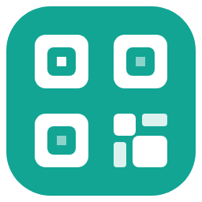
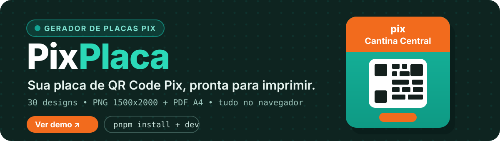
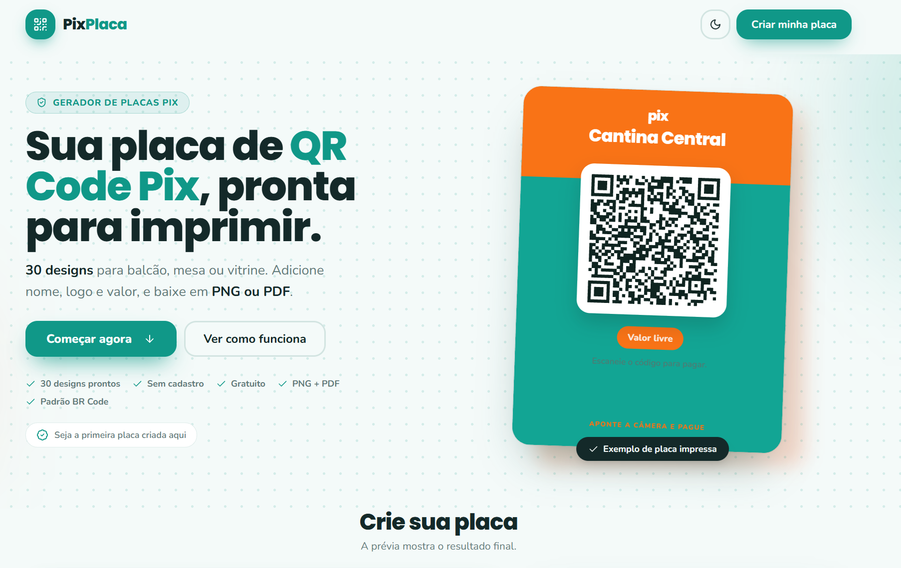
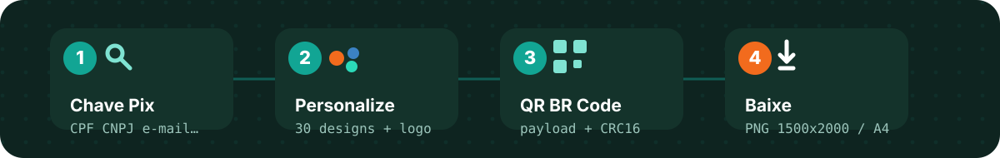

<p align="center">
  <picture>
    <source srcset="./docs/assets/pixplaca-logo-static.png" media="(prefers-reduced-motion: reduce)" />
    <source srcset="./docs/assets/pixplaca-logo-animated.gif" type="image/gif" />
    
  </picture>
</p>

<p align="center">
  
</p>

<p align="center">
  <a href="https://hypertechdevelopment.github.io/pixplaca/"><strong>Live demo</strong></a>
  ·
  <a href="README.md">Versão em português</a>
  <br />
  <a href="https://github.com/sponsors/HyperTechDevelopment"></a>
  
  
  
</p>

Create Pix QR Code signs with **30 designs** in 4 styles — minimal, colorful, playful and corporate. Customize, preview instantly and download as **PNG** or **PDF**. Nothing leaves the browser.



## How it works

<p align="center">
  
</p>

1. **Enter your Pix key** — CPF and CNPJ go through check-digit validation.
2. **Customize** — name, city, message, fixed or open amount, logo and accent color. Wide or tall logos fit the sign space on their own.
3. **BR Code QR** — payload generated locally, with CRC16.
4. **Download** — 1500×2000 px PNG or A4 PDF.

## Run it

```bash
pnpm install
pnpm dev
```

Production build:

```bash
pnpm build
```

## Where things live

| File | Responsibility |
| --- | --- |
| `src/lib/pix.ts` | BR Code payload, CRC16 and key validation |
| `src/lib/designs.ts` | The 30-design catalog |
| `src/components/PlateCanvas.tsx` | The 10 sign layouts |
| `src/components/Studio.tsx` | Editor, gallery and download |
| `src/lib/export.ts` | PNG and A4 PDF export |
| `src/lib/usePlateCount.ts` | Local counter of generated signs |

## Security

Everything runs in the browser: the key, the QR generation and the download. No server receives the data. Logo upload accepts PNG, JPG and WebP only, capped at 2 MB. The security policy (CSP) ships in `index.html` itself, since GitHub Pages doesn't send server headers.

## License

MIT — see the [LICENSE](LICENSE) file.
