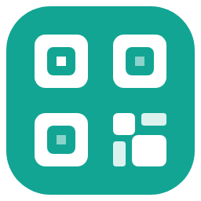
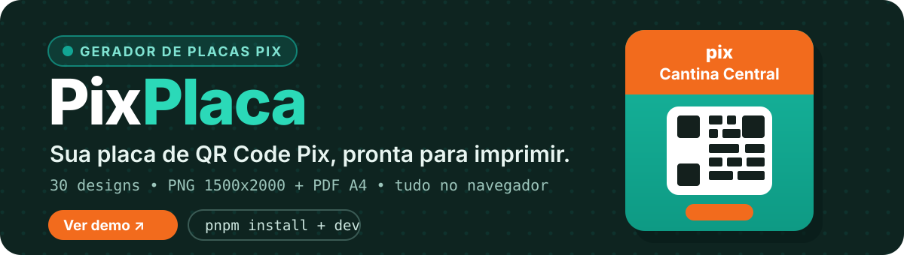
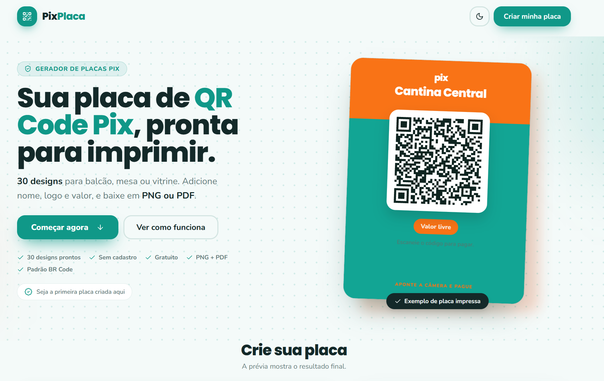
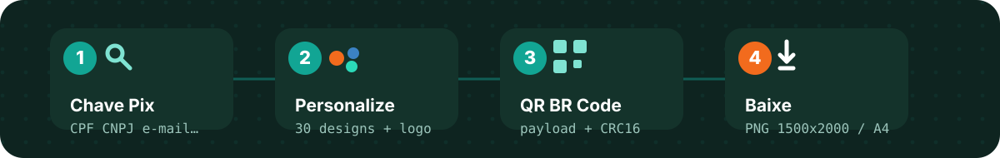

<p align="center">
  <picture>
    <source srcset="./docs/assets/pixplaca-logo-static.png" media="(prefers-reduced-motion: reduce)" />
    <source srcset="./docs/assets/pixplaca-logo-animated.gif" type="image/gif" />
    
  </picture>
</p>

<p align="center">
  
</p>

<p align="center">
  <a href="https://hypertechdevelopment.github.io/pixplaca/"><strong>Ver demo</strong></a>
  ·
  <a href="README.en.md">English version</a>
  <br />
  <a href="https://github.com/sponsors/HyperTechDevelopment"></a>
  
  
  
</p>

Crie placas de QR Code Pix com **30 designs** em 4 estilos — minimalista, colorido, divertido e corporativo. Personalize, visualize na hora e baixe em **PNG** ou **PDF**. Nada sai do navegador.



## Como funciona

<p align="center">
  
</p>

1. **Informe a chave Pix** — CPF e CNPJ passam por validação de dígito verificador.
2. **Personalize** — nome, cidade, mensagem, valor fixo ou livre, logo e cor de destaque. Logos largas ou altas se ajustam sozinhas ao espaço da placa.
3. **QR no padrão BR Code** — payload gerado localmente, com CRC16.
4. **Baixe** — PNG de 1500×2000 px ou PDF em folha A4.

## Uso

```bash
pnpm install
pnpm dev
```

Build de produção:

```bash
pnpm build
```

## Onde fica o quê

| Arquivo | Responsabilidade |
| --- | --- |
| `src/lib/pix.ts` | Payload BR Code, CRC16 e validação de chave |
| `src/lib/designs.ts` | Catálogo dos 30 designs |
| `src/components/PlateCanvas.tsx` | Os 10 layouts de placa |
| `src/components/Studio.tsx` | Editor, galeria e download |
| `src/lib/export.ts` | Exportação PNG e PDF A4 |
| `src/lib/usePlateCount.ts` | Contador local de placas geradas |

## Segurança

Tudo roda no navegador: a chave, a geração do QR e o download. Nenhum servidor recebe os dados. Upload de logo aceita só PNG, JPG e WebP, com limite de 2 MB. A política de segurança (CSP) vai direto no `index.html`, pois o GitHub Pages não envia cabeçalhos de servidor.

## Licença

MIT — veja o arquivo [LICENSE](LICENSE).
